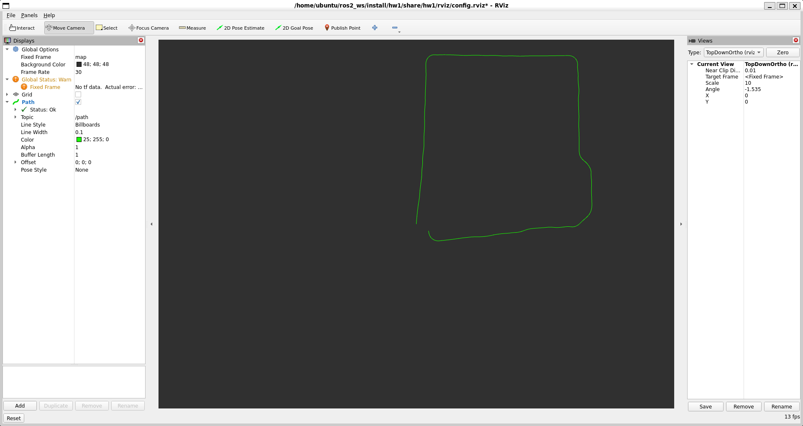

# 作业一报告：基于编码器位移与 IMU 航向角的二维航位推算

#### 杨家铭 2400012908

## 1. 作业目标与数据流

实验目标是根据机器人每个采样周期的位移增量和 IMU 提供的当前航向角，实时估计机器人在平面中的位置与姿态，并以 ROS 2 `nav_msgs/Odometry` 消息发布。数据文件为 `hw1/data/data.csv`，包含 `cur_ori` 和 `distance` 两列，共 2201 条样本。`hw1` 包中的 `CsvPublisher` 以 30 Hz 读取 CSV，并发布自定义消息 `/hw1/deadreckoning_data`；`hw1_answer` 包中的 `answer` 节点订阅该话题，完成航位推算后发布 `/hw1/odom`；`visualization` 包中的 `trajectory_visualization` 节点再将连续位姿转换成 `/path`，供 RViz 绘制绿色轨迹。

整体数据流如下：

```text
data.csv
   │ 30 Hz
   ▼
/hw1/deadreckoning_data
   │ cur_ori, distance
   ▼
hw1_answer/answer（积分位置与姿态）
   │ nav_msgs/Odometry
   ├──────────────► /hw1/odom
   ▼
trajectory_visualization
   │ 累积 PoseStamped
   ▼
/path ───────────► RViz
```

启动文件 `hw1/launch/hw1.launch.py` 会同时启动 CSV 发布节点、答案节点、轨迹可视化节点和 RViz。RViz 的固定坐标系设置为 `map`，显示 `/path` 话题，因此截图中的绿色线条表示估计轨迹，而不是激光地图或真实轨迹。

## 2. 航位推算模型

设第 $k$ 个采样时刻的机器人位置为 $(x_k,y_k)$，IMU 航向角为 $\theta_k$，编码器给出的本周期位移为 $\Delta s_k$。本实现假定这个位移沿机器人当前朝向方向发生，因此位置递推为

$$
x_k=x_{k-1}+\Delta s_k\cos\theta_k,
\qquad
y_k=y_{k-1}+\Delta s_k\sin\theta_k.
$$

节点从原点开始初始化：$x_0=0$、$y_0=0$、$\theta_0=0$。每收到一条消息，直接用当前 `msg.cur_ori` 覆盖航向角，再将当前距离增量投影到全局 `x/y` 方向并累加。代码的核心部分如下：

```python
def deadreckoning_callback(self, msg):
    self.theta = msg.cur_ori
    self.x += msg.distance * math.cos(self.theta)
    self.y += msg.distance * math.sin(self.theta)
```

这种写法使用 IMU 的绝对航向角，而不是对角速度再次积分，因此避免了额外的角度积分步骤。它也意味着输入的 `cur_ori` 必须已经是弧度，并且与地图坐标系的正方向约定一致。CSV 中的角度范围约为 `-0.80` 到 `5.45` rad，说明数据包含多圈转动和跨越 $2\pi$ 的航向变化；三角函数本身可以自然处理这种未归一化角度。

## 3. Odometry 消息与姿态表示

答案节点将每条输入消息的时间戳复制到 Odometry 的 `header.stamp`，并设置：

```python
odom.header.frame_id = 'map'
odom.child_frame_id = 'base_link'
odom.pose.pose.position.x = self.x
odom.pose.pose.position.y = self.y
```

ROS 2 的姿态字段使用四元数。由于本题是二维运动，只需要绕 Z 轴旋转，令滚转角和俯仰角为 0，则航向角 $\theta$ 对应的四元数为

$$
q_x=0,\quad q_y=0,\quad
q_z=\sin\left(\frac{\theta}{2}\right),\quad
q_w=\cos\left(\frac{\theta}{2}\right).
$$

对应代码为：

```python
odom.pose.pose.orientation.z = math.sin(self.theta / 2.0)
odom.pose.pose.orientation.w = math.cos(self.theta / 2.0)
self.odom_publisher.publish(odom)
```

没有被使用的 Z 位置和线速度字段保持默认值。这符合本作业只要求平面位置和航向的设定；如果下游节点需要完整的速度协方差或 TF，则还应进一步补充相关字段。

## 4. 轨迹可视化实现

`trajectory_visualization.py` 订阅 `/hw1/odom`，在每次回调中提取 `position.x` 和 `position.y`，构造一个 `PoseStamped` 并追加到 `Path.poses`：

```python
pose = PoseStamped()
pose.header = msg.header
pose.pose = msg.pose.pose
self.path.poses.append(pose)
self.path.header.stamp = self.get_clock().now().to_msg()
self.path_pub.publish(self.path)
```

路径的 `frame_id` 设为 `map`，所以 RViz 可以直接在固定坐标系中显示。该节点没有重新计算位置，也没有对轨迹进行平滑或滤波；它只是把答案节点发布的离散位姿连接起来。因而轨迹形状主要反映航位推算误差、输入数据噪声和采样间隔。

## 5. 结果截图与分析



**图 1　RViz 轨迹结果。** 截图显示 `/path` 已正常接收并绘制为绿色折线。轨迹整体形成一个接近矩形的闭合运动路线，四条边较为清楚，右侧和底部转弯处存在圆滑过渡或轻微偏移。左下附近的起点与终点没有完全重合，说明经过一圈运动后存在累计误差。该现象符合纯航位推算的特点：每个周期的位移误差和航向误差都会被累积，无法像激光 SLAM 那样通过环境特征进行全局校正。

从数据统计看，所有 `distance` 增量之和约为 155.47 m，但最终位移并不是各段距离的简单相加，而是按照每个时刻的航向角分别投影到 X、Y 方向后得到。因此机器人虽然走过较长路径，最终位置仍可能靠近起点。结果图中的闭环形状表明位移方向和航向角的组合是有效的。

## 6. 误差来源与改进方向

1. **航向误差累积。** 位置增量使用 $\cos\theta$ 和 $\sin\theta$ 投影，航向角的小偏差会直接改变每一步的投影方向，长时间运行后会造成明显的横向漂移。
2. **位移测量误差。** 编码器给出的 `distance` 若存在比例误差、打滑或量化误差，积分后会表现为轨迹尺度变化和起终点不闭合。
3. **时间同步。** CSV 发布器使用当前 ROS 时间作为消息时间戳，本题的答案节点按到达顺序处理数据，没有做时间插值。对于固定 30 Hz 数据这已经足够简单可靠，但真实传感器系统还应检查传感器时钟和消息延迟。
4. **初始状态假设。** 实现将初始位置和航向设为 0。如果实际实验开始时机器人不在地图原点，需通过参数或初始位姿消息设置初值。
5. **可进一步改进。** 通过搜索和调查，我认为可以加入轮距或编码器标定、异常增量剔除、协方差估计；如果环境中存在可观测地标，还可以与视觉或激光定位结合，减少闭环漂移。

## 7. 运行方法与结论

在工作区构建并加载环境后，运行 HW1 启动文件即可复现实验：

```bash
cd /home/ubuntu/ros2_ws
source /opt/ros/humble/setup.bash
colcon build --packages-select hw1_msgs hw1 hw1_answer visualization
source install/setup.bash
ros2 launch hw1 hw1.launch.py
```

本次实验主要是将离散位移按照 IMU 当前航向角投影到全局平面，并以标准 Odometry 消息发布，再通过 Path 在 RViz 中显示。实现结构清晰、计算量小，能够恢复数据中的主要运动轮廓；但它属于开环航位推算，误差会随路程累积，不能保证长时间运行后轨迹闭合。
