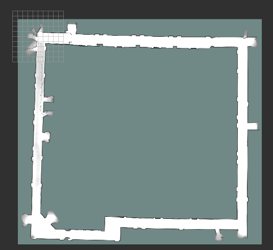
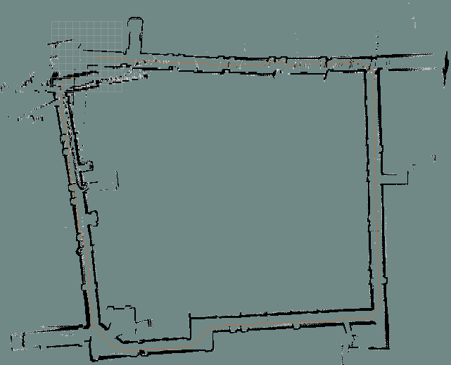
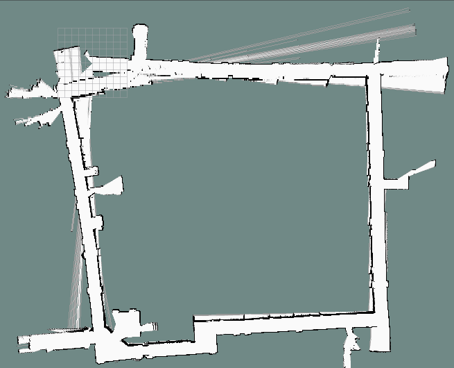

# 作业二报告：二维激光占据栅格建图

#### 杨家铭 2400012908

## 1. 任务与数据

本作业利用录制的 ROS 2 bag 中的激光扫描、里程计及 IMU 数据，生成并比较三种二维地图：简单端点投票（`simple_map`）、Cartographer 和对数几率建图（`log_odds`）。三种方案均通过 `/map` 发布 `nav_msgs/OccupancyGrid`，在 RViz 中查看结果。输入激光话题为 `/urg_node/scan`；两种自行实现的建图节点使用 `/encoder_imu_node/odom` 提供的位姿，Cartographer 还使用 `/encoder_imu_node/cartoimu`。本文使用 `figs/` 中已有的三张运行截图进行定性分析。

## 2. 总体思路与坐标处理

先将每帧激光与时间最接近的里程计位姿配对，再将有效量测点由激光坐标系变换到地图坐标系。代码从四元数提取平面航向角 `yaw`，取激光相对机器人原点的平面偏移为 `(-0.05, 0)` m。对距离为 $r$、扫描角度为 $\alpha$ 的光束，有

$$
\begin{bmatrix}x_m\\y_m\end{bmatrix}
=\begin{bmatrix}x_r\\y_r\end{bmatrix}
+R(\theta)\left(
\begin{bmatrix}-0.05\\0\end{bmatrix}
+r\begin{bmatrix}\cos\alpha\\\sin\alpha\end{bmatrix}
\right),\qquad
R(\theta)=\begin{bmatrix}\cos\theta&-\sin\theta\\\sin\theta&\cos\theta\end{bmatrix}.
$$

只有满足 `range_min < r < range_max` 且为有限数的读数参与建图。自行实现的两种方案使用 0.10 m 栅格，通过 `floor(x / resolution)` 确定单元；地图范围由已观测单元动态扩展，周围再留 10 格边界。尚未被观测的格子用占据栅格的 `-1` 表示。

## 3. 三种方法的实现

### 3.1 simple_map：激光端点投票

`simple_mapping.py` 为每个有效激光端点计算地图栅格坐标，并在字典中累计命中次数。发布时，将命中数映射为 `min(100, count * 20)`，所以一个栅格累计五次命中后就达到最大占据值。核心逻辑为：

```python
cell = (math.floor(world_x / self.resolution),
        math.floor(world_y / self.resolution))
self.votes[cell] = self.votes.get(cell, 0) + 1
# 发布地图时：data[index] = min(100, count * 20)
```

此方法实现简单，计算量主要与有效光束数成正比。它只记录障碍物端点，没有给激光路径经过的格子写入空闲证据，因此房间内部即使被激光扫过，也仍可能显示为未知区域。它直接依赖已有里程计位姿；如果轨迹漂移，同一面墙的重复观测可能落在不同栅格，造成墙体变厚或错位。位姿采用最近时间戳匹配，未做时间插值。



**图 1　simple_map 结果。** 截图中房间的四周轮廓基本连续，局部拐角和左侧开口附近有较厚的点迹；大面积内部没有被此方法明确标为自由空间。这与仅累加端点命中的实现一致。

### 3.2 Cartographer：扫描匹配与子地图

`hw2_cartographer.launch.py` 启动静态坐标变换、`cartographer_node`、占据栅格发布节点、RViz 和 bag 回放。激光、IMU、里程计分别映射到 Cartographer 的 `scan`、`imu`、`odom` 输入。配置文件 `config/hw2_2d.lua` 启用二维轨迹构建、IMU 与里程计，并打开在线相关性扫描匹配；位姿图每 35 个节点进行一次优化。Cartographer 使用激光扫描构造局部子地图，结合扫描匹配估计位姿，再通过位姿图约束改善整体一致性。最终由 `cartographer_occupancy_grid_node` 以 **0.05 m** 分辨率发布地图。

```lua
TRAJECTORY_BUILDER_2D.use_imu_data = true
TRAJECTORY_BUILDER_2D.use_online_correlative_scan_matching = true
POSE_GRAPH.optimize_every_n_nodes = 35
```

与直接按里程计投点的方案相比，扫描匹配使相邻帧能够利用环境几何进一步校正相对位置；位姿图优化也为全局调整提供机制。是否发生了有效的回环校正，不能仅凭一张最终截图确认。



**图 2　Cartographer 结果。** 房间四条主要边界可以辨认，墙体点迹相对细，橙色轨迹沿房间外围连续分布。局部开口和左上角仍有散点与不完整边界。

### 3.3 log_odds：射线更新与概率占据

在要求完成的两个实验之外，我还加了一个其他的mapping方法，即log_odds：利用 Bresenham 算法遍历从激光原点到命中点的栅格。


`log_odds_mapping.py` 仍用时间最近的里程计位姿变换激光，但不只记录终点。它利用 Bresenham 算法遍历从激光原点到命中点的栅格：终点前的单元收到空闲更新 `-0.40`，终点收到占据更新 `+0.85`。每个栅格保存对数几率 $L$，累加后限制在 $[-4,4]$，发布时按 $p=1/(1+e^{-L})$ 转换为 `0–100` 的占据值：

```python
for cell in ray_cells[:-1]:
    self.add_vote(cell, self.free_vote)      # -0.40
self.add_vote(ray_cells[-1], self.occupied_vote)  # +0.85
# self.log_odds[cell] = clamp(old_value + vote, -4.0, 4.0)
```

这里的加权更新相当于让障碍物端点和射线穿过区域分别积累相反证据；限制幅度可避免长期重复观测让数值无限增长。未触及的格子保持未知。相比 simple_map，它能表示已探测的空闲区域，但每条射线要更新沿途多个格子，处理量更高。



**图 3　log_odds 结果。** 主要房间轮廓可辨，房间内部和墙体附近有更丰富的已观测区域；上方、左侧等位置存在细长的放射状痕迹。就现有实现而言，这些痕迹可能与单帧异常量测、位姿误差或沿射线累积更新有关。我自己感觉以目前效果看这个log_odds必须要加入一些其他的优化，否则它仍依赖里程计，不能规避或缩小误差。

## 4. 结果比较与分析

| 比较项目 | simple_map | Cartographer | log_odds |
| --- | --- | --- | --- |
| 位姿来源 | 最近时间戳的已有里程计 | 里程计、IMU 与激光扫描匹配 | 最近时间戳的已有里程计 |
| 地图更新 | 仅端点命中次数 | 扫描匹配、子地图与位姿图 | 射线空闲证据 + 端点占据证据 |
| 本次地图分辨率 | 0.10 m | 0.05 m | 0.10 m |
| 自由空间表达 | 无显式射线清空 | 由 Cartographer 地图生成过程处理 | 显式沿射线更新 |
| 截图表现 | 外轮廓清楚，内部信息少 | 主要边界较细，轨迹连续 | 内部信息较丰富，有少量射线痕迹 |
| 主要代价与限制 | 实现和计算最省，但依赖里程计 | 配置与计算更复杂 | 逐格射线更新较耗时，仍受里程计误差影响 |

从截图看，三个结果都恢复了近似矩形房间及局部开口，说明激光点到地图的坐标变换与基本数据流可用。simple_map 足以快速勾勒墙面，但“没有端点”不等于“已知空闲”，因此不能直接将未命中区域解释为空地。log_odds 通过空闲与占据双向更新提供更完整的占据语义，也更容易暴露异常射线留下的痕迹。Cartographer 的墙线在截图中较细、轨迹较平顺，符合扫描匹配对局部对齐的帮助。

## 5. 运行方式与结论

在 ROS 2 Humble 环境中构建包，随后分别启动三种方法；启动文件默认从 `/hw2_data` 回放 bag，也可通过 `bag_file:=路径` 和 `rate:=倍率` 修改输入与速度。

```bash
cd /home/ubuntu/ros2_ws
source /opt/ros/humble/setup.bash
colcon build --packages-select hw2_answer
source install/setup.bash
ros2 launch hw2_answer hw2_answer.launch.py
ros2 launch hw2_answer hw2_cartographer.launch.py
ros2 launch hw2_answer hw2_log_odds.launch.py
```

以上三条 `ros2 launch` 命令需分别运行，每次对应一种地图。综合实现与截图，simple_map 适合作为快速基线；log_odds 在仍使用现成里程计的前提下补足了自由空间表达；Cartographer 则通过扫描匹配和子地图提供更完整的建图流程。
